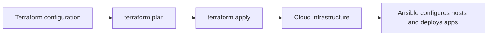

# Terraform vs Ansible

Both Terraform and Ansible can automate infrastructure work, but they are
commonly used for different parts of the process.

## Can Ansible create infrastructure?

Yes. With the appropriate collections and cloud credentials, Ansible can
create, update, and delete resources such as EC2 instances, S3 buckets, VPCs,
subnets, and security groups.

Ansible is commonly used for configuration management and application
deployment. Its modules are often idempotent, but Ansible does not provide
Terraform's built-in infrastructure state and plan workflow for tracking the
desired lifecycle of resources.

## Why use Terraform for provisioning?

Terraform uses a **declarative** approach: describe the infrastructure you
want, and Terraform calculates the changes needed to move the real
infrastructure toward that desired state.

For example, configuration can describe two EC2 instances, one VPC, two
subnets, and a security group. Terraform compares that configuration with its
state and the provider's view of the infrastructure, then proposes changes
with `terraform plan` before applying them.

Terraform state maps declared resources to real resources. Store and protect
it carefully; state can contain sensitive values. A remote backend can support
shared team workflows and state locking when the backend provides it.

## Typical workflow

## Quick comparison

| Area | Terraform | Ansible |
|---|---|---|
| Common use | Provision and manage infrastructure lifecycle | Configure systems, deploy applications, and automate tasks |
| Approach | Declarative desired infrastructure | Automation tasks and desired configuration, often idempotent |
| State and planning | Maintains state and provides a plan workflow | No Terraform-style built-in infrastructure state and plan workflow |
| Can provision cloud resources? | Yes; a common primary use | Yes, using cloud modules and collections |
| Typical example | Create VPCs, subnets, instances, and security groups | Install Nginx, configure services, and deploy application files |

## Using them together

1. Use Terraform to define and provision the cloud infrastructure.
2. Review the proposed changes with `terraform plan`.
3. Apply the approved changes with `terraform apply`.
4. Use Ansible to configure the provisioned servers and deploy applications.

Terraform is often preferred for managing the full infrastructure lifecycle
because of its state and plan workflow. Ansible can also provision resources;
the best choice depends on the environment and the workflow you need.