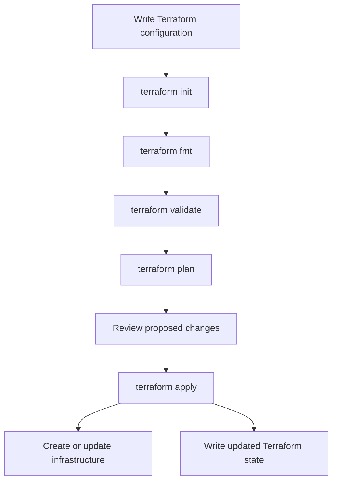

# Terraform Workflow

Terraform's core workflow is **Write → Initialize → Format and Validate →
Plan → Apply**. Terraform compares your configuration with its state and the
real infrastructure to determine what changes are needed.



## 1. Write the configuration

Create Terraform configuration files, usually with the `.tf` extension. They
describe the providers and resources you want Terraform to manage. For example,
you might define a cloud provider, a virtual network, subnets, security
groups, and virtual machines.

Terraform configuration describes the **desired state**. It is not a sequence
of imperative commands such as "create this, then change that."

## 2. Initialize the working directory

Run this command from the directory containing your Terraform configuration:

```bash
terraform init
```

`terraform init` prepares the directory for Terraform operations. It downloads
the required provider plugins, initializes the configured backend for state,
and creates or updates the local `.terraform` working directory. It may also
create or update `.terraform.lock.hcl`, which records selected provider
versions and checksums.

Run `terraform init` when you start a new configuration directory, change
provider requirements, or change backend configuration.

## 3. Format the configuration

```bash
terraform fmt
```

`terraform fmt` formats Terraform files into a consistent style. It changes
files in place. To check formatting without changing files, use:

```bash
terraform fmt -check
```

Formatting is not required for Terraform to understand valid configuration,
but consistent formatting makes it easier to review.

## 4. Validate the configuration

```bash
terraform validate
```

`terraform validate` checks the configuration for errors such as invalid
syntax, incorrect argument names, and incompatible value types. Initialize
the directory first so Terraform has the required providers and modules.

Validation checks the configuration's internal consistency. It does **not**
contact the cloud provider to confirm credentials, permissions, quotas, or
whether a particular resource can successfully be created.

## 5. Create and review a plan

To see the proposed infrastructure changes, run:

```bash
terraform plan
```

Terraform loads the configuration, checks the current state, and normally
queries the provider for the current details of managed resources. It then
shows the actions it proposes, such as creating, updating, or deleting
resources. A plan does not apply those proposed infrastructure changes.

Review the plan carefully, especially any actions marked for destruction or
replacement. To save a plan for later review and application:

```bash
terraform plan -out=tfplan
terraform show tfplan
```

A saved plan can contain sensitive values. Protect it and do not commit it to
source control.

## 6. Apply the plan

For an interactive plan-and-apply workflow:

```bash
terraform apply
```

Terraform displays the proposed changes and asks for confirmation before
making them. Review the plan, then enter `yes` to continue.

To apply a previously saved plan:

```bash
terraform apply tfplan
```

Terraform performs the planned actions through the provider. On successful
resource operations, it records the resulting resource information in state.

## What happens to the state file?

**Yes—after a successful apply, Terraform creates or updates state.** With the
default local backend, the state is normally stored in a file named
`terraform.tfstate` in the working directory. Terraform uses state to map
resources in your configuration to real infrastructure and to track values
needed for future plans and operations.

The state file is not just a list of resource names. It can contain sensitive
information, so do not edit it manually, expose it publicly, or commit it to
Git. Add local state and plan files to `.gitignore`, and use a secured remote
backend for shared or production workflows.

When a remote backend is configured, state is stored by that backend instead
of being kept as the primary local `terraform.tfstate` file. Some backends also
support state locking to help prevent concurrent operations.

Terraform may save state updates as operations complete, including when an
apply encounters an error after some resources have already changed. If that
happens, inspect the output and run a new `terraform plan` before deciding
what to do next; do not assume the infrastructure was rolled back.

## 7. Make later changes

Edit the configuration to describe the new desired state, then run:

```bash
terraform fmt
terraform validate
terraform plan
terraform apply
```

Terraform compares the updated configuration with the state and the provider's
view of the infrastructure. It proposes only the changes needed to reconcile
them. Review the plan before applying it.

## 8. Destroy managed infrastructure

When you no longer need the resources managed by the configuration, review and
run:

```bash
terraform plan -destroy
terraform destroy
```

`terraform destroy` asks for confirmation before deleting the resources
Terraform manages in that working directory and state. Deletion may be
irreversible, so check the target workspace, backend, and plan carefully.

## Command summary

| Command | Purpose |
|---|---|
| `terraform init` | Initialize the working directory, backend, providers, and modules |
| `terraform fmt` | Format Terraform configuration files |
| `terraform validate` | Check configuration syntax and internal consistency |
| `terraform plan` | Preview proposed infrastructure changes |
| `terraform show tfplan` | Inspect a saved plan |
| `terraform apply` | Apply a reviewed plan and update state |
| `terraform plan -destroy` | Preview resource deletions |
| `terraform destroy` | Delete resources managed by the current configuration and state |