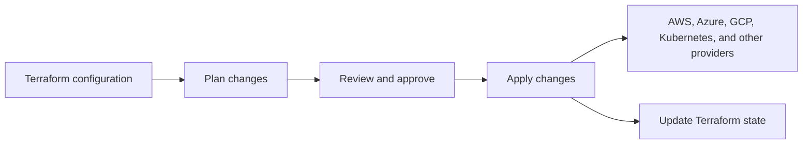

# Why Terraform Instead of CloudFormation?

AWS CloudFormation is a capable AWS-native Infrastructure as Code (IaC) tool.
Terraform is often chosen when teams want one workflow across multiple
providers, a broad provider ecosystem, reusable modules, or integration with
existing CI/CD pipelines. The right choice depends on the organization's
requirements; CloudFormation can be a strong fit for AWS-focused environments.

## 1. Cloud-agnostic provider ecosystem

- **CloudFormation** manages AWS resources.
- **Terraform** has providers for AWS, Azure, Google Cloud, Kubernetes,
  GitHub, Helm, Datadog, and many other platforms and services.

If a company adopts Azure or Google Cloud, Terraform can manage those
resources with the same tool and workflow. The resource configuration still
needs to use the relevant provider; moving between clouds is not usually a
matter of changing only one setting.

## 2. Multi-cloud support

Terraform can manage resources from multiple providers in one configuration.
For example, a team could manage cloud infrastructure alongside Kubernetes
and GitHub resources. Separate configurations or modules may be preferable
when teams, access boundaries, or resource lifecycles differ.

## 3. State management

- Terraform records the resources it manages in state, which maps the
  configuration to real resources and stores information used for future
  plans.
- State can be stored locally or in a remote backend. A remote backend can
  support team access and state locking, depending on the backend.
- State may contain sensitive values and must be protected.

CloudFormation also tracks stack resources and deployment state. Terraform's
state is an explicit part of its workflow, which can provide useful
visibility and flexibility, but also means teams must manage and secure it.

## 4. Modular and reusable code

Terraform modules package related resources into reusable building blocks.
Teams can use modules to standardize infrastructure and pass different input
values for environments such as development, testing, and production.

## 5. Broad provider and community ecosystem

Terraform has a large provider ecosystem for cloud platforms and other
services, including AWS, Kubernetes, GitHub, Helm, and Datadog. CloudFormation
is focused on AWS resources and integrations.

## 6. CI/CD integration

Terraform commands can be run from CI/CD pipelines to format and validate
configuration, generate plans for review, and apply approved changes. Pipeline
credentials and Terraform state must be handled securely.

## Simplified workflow

In short, Terraform is commonly preferred when teams need a consistent IaC
workflow across providers, reusable modules, and explicit state management.
CloudFormation remains a good option for infrastructure managed specifically
with AWS.